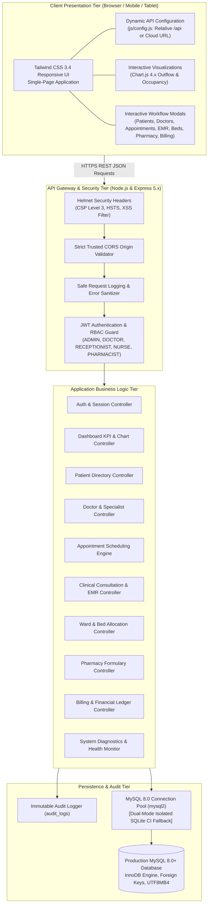

# 🏥 NovaCare Hospital Management System (HMS)

<div align="center">

[](https://github.com/danishalipny-pixel/NovaCare-Medical-Center)
[](https://nodejs.org/)
[](https://expressjs.com/)
[](https://www.mysql.com/)
[](https://tailwindcss.com/)
[-success?style=for-the-badge&logo=checkmarx&logoColor=white)](#-automated-testing--verification-suite)
[](LICENSE)

<br/>

**A modern, responsive, full-stack hospital management system engineered for hospitals, clinics, and healthcare networks.**  
*Managing Patients • Doctors • Appointments • EMR Records • Prescriptions • Inpatient Wards & Beds • Pharmacy Catalog • Financial Billing & Invoicing • Role-Based Access Control*

[Live API Health](#-system-diagnostics--api-health-monitor) • [Quick Start](#-quick-start-local-development) • [Role Test Accounts](#-role-based-access-control-rbac--demo-accounts) • [REST API Directory](#-complete-rest-api-endpoint-directory) • [Deployment Manual](#-live-hosting--cloud-deployment)

</div>

---

## 📋 Table of Contents
1. [Executive Overview & Highlights](#-executive-overview--highlights)
2. [System Architecture & Data Flow](#-system-architecture--data-flow)
3. [Core Hospital Clinical Modules](#-core-hospital-clinical-modules)
4. [Role-Based Access Control (RBAC) & Demo Accounts](#-role-based-access-control-rbac--demo-accounts)
5. [Technology Stack](#-technology-stack)
6. [Quick Start (Local Development)](#-quick-start-local-development)
7. [Automated Testing & Verification Suite](#-automated-testing--verification-suite)
8. [Production API & Zero-Localhost Configuration](#-production-api--zero-localhost-configuration)
9. [Complete REST API Endpoint Directory](#-complete-rest-api-endpoint-directory)
10. [Live Hosting & Cloud Deployment](#-live-hosting--cloud-deployment)
11. [Security & Compliance Hardening](#-security--compliance-hardening)
12. [Disaster Recovery & Database Backups](#-disaster-recovery--database-backups)
13. [Contributing & License](#-license)

---

## 🌟 Executive Overview & Highlights

**NovaCare Hospital Management System (HMS)** is a production-grade healthcare information system built from the ground up to streamline medical operations, safeguard confidential clinical histories, and optimize operational workflows.

### Key Operational Capabilities
- **Universal Health Identifier (UHID)**: Automated generation of unique medical IDs (`NC-2026-XXXX`) compliant with global patient identification standards.
- **Conflict-Free Appointment Scheduling**: Double-booking prevention engine that verifies physician availability and room occupancy before slot reservation.
- **Electronic Medical Records (EMR)**: Encounter documentation with vitals tracking (Blood Pressure, Heart Rate, SpO2, Temperature) and digital prescription authoring.
- **Live Inpatient Bed Matrix**: Visual ward grid with instant bed allocation, admission tracking, and discharge summary generation.
- **Real-Time Pharmacy Formulary**: Inventory ledger with automatic stock reorder thresholds (`Available`, `Low Stock`, `Out of Stock`) and dosage dispensation.
- **Financial Accounting Ledger**: Itemized invoice creation with auto-calculated consultation fees, lab procedures, medications, tax, and multi-method payments.
- **Zero-Localhost Leak Guarantee**: Runtime configuration that dynamically detects origin, enabling single-origin or decoupled cloud deployment.
- **Immutable Audit Trail**: Append-only activity logging capturing user ID, action, resource, timestamp, and IP address for full regulatory compliance.

---

## 🏛️ System Architecture & Data Flow



---

## 🏥 Core Hospital Clinical Modules

### 1. Executive Operations Dashboard & KPI Analytics
- **Live KPI Counters**: Real-time counts for Active Patients, Today's Consultations, Inpatient Bed Occupancy, Settled Outpatient Revenue, Pending Ledger Balances, and Low-Stock Drug Reorder Alerts.
- **Interactive Chart.js Visualizations**:
  - *Weekly Patient Outflow Trend* (Smooth Line Chart with daily admissions/discharges).
  - *Department Consultation Load* (Bar Chart displaying patient visits by specialty).
  - *Ward Bed Occupancy Ratio* (Doughnut Chart breaking down ICU, General, and Private suites).
- **Chronological Audit Stream**: Real-time feed displaying administrative, medical, and financial events.

### 2. Universal Patient Directory (UHID)
- Auto-generates standardized Universal Health Identifiers (`NC-2026-XXXX`).
- Captures comprehensive demographic profiles: Full Name, Date of Birth, Gender, Blood Group, Phone, Email, Residential Address, Emergency Contact, Known Drug/Food Allergies, Chronic Conditions, and Insurance Policy details.
- Real-time debounced query search across UHID, Name, and Phone number with instant Gender filtering.
- **Soft-Deletion Protection**: Patients are soft-deleted (`is_deleted = 1`); clinical notes, diagnostic history, and financial receipts are permanently preserved.

### 3. Outpatient Appointment Scheduling & Conflict Protection
- Assigns appointments to specific physicians with consultation dates, times, room suites, and appointment types (Follow-up, Routine Checkup, Emergency, Specialist Consultation).
- **Conflict Engine**: Automatically prevents double-booking a doctor for overlapping slots, returning an HTTP `409 Conflict` with a human-readable advisory.
- Lifecycle tracking: `Scheduled` ➔ `Completed`, `Cancelled`, or `No-Show`.

### 4. Specialist Physician & Medical Staff Directory
- Manages licensed doctors categorized by department: Cardiology, Neurology, Pediatrics, Orthopedics, and General Medicine.
- Tracks board qualifications, consulting room suites, consultation fees, and weekly duty schedules.
- Seamless doctor creation with department-linked OPD room allocation.

### 5. Electronic Medical Records (EMR) & Clinical Consultations
- Structured clinical documentation capturing Symptoms, Physical Examination Findings, and Primary Diagnostic Impressions.
- **Vital Signs Matrix**: Systolic/Diastolic Blood Pressure (mmHg), Heart Rate (bpm), Body Temperature (°C), and Oxygen Saturation (SpO2 %).
- **Digital Prescriptions**: Structured medication orders with dosages, frequencies, treatment duration, and patient counseling instructions.

### 6. Inpatient Department (IPD), Wards & Visual Bed Matrix
- Interactive visual grid tracking beds across Intensive Care Unit (ICU), General Male Ward, General Female Ward, Pediatric Ward, and Executive Private Suites.
- Live status indicators: `Available` (Emerald), `Occupied` (Rose), and `Maintenance` (Amber).
- Real-time Patient Admission to available beds and Clinical Discharge workflow with automatic bed status restoration.

### 7. Pharmacy Formulary & Inventory Control
- Complete formulary catalog: Brand Name, Generic Chemical Composition, Therapeutic Category, Dosage Form, Unit Price, Current Stock, and Manufacturer.
- Automatic inventory threshold indicators: `Available`, `Low Stock`, and `Out of Stock`.
- Direct prescription dispensation deducting stock units from the active catalog with audit logging.

### 8. Hospital Accounts, Invoicing & Financial Ledger
- Multi-item invoice generator supporting Consultation Fees, Bed Charges, Surgical Procedures, Medications, and Diagnostic Laboratory Tests.
- Automatic calculation of subtotal, percentage discounts, standard healthcare tax, and net balance due.
- Payment recording supporting Cash, Credit Card, Debit Card, Insurance Claims, and Direct Bank Transfers.
- Payment state transitions: `Unpaid` ➔ `Partial` ➔ `Paid`.
- Clean, print-ready formal invoice receipts.

### 9. System Diagnostics & API Health Monitor
- Comprehensive health endpoint (`GET /api/health`) reporting:
  - Overall system status (`healthy`).
  - Database connectivity engine (`mysql` or fallback `sqlite`).
  - Query roundtrip latency (in milliseconds).
  - Process uptime, Node.js version, and heap memory usage.
- **Zero Information Leakage**: Strictly shields internal database credentials, server filepaths, and stack traces.

---

## 🔐 Role-Based Access Control (RBAC) & Demo Accounts

NovaCare implements strict server-side role-based authorization using JSON Web Tokens (JWT) signed with HMAC-SHA256.

The application includes pre-seeded demonstration accounts with **1-Click Quick Fill** buttons in the login modal:

| Role | Username | Password | Accessible Capabilities |
| :--- | :--- | :--- | :--- |
| **System Administrator** | `admin` | `Admin@123` | Unrestricted access across all clinical, administrative, staff, and financial modules. |
| **Consulting Physician** | `dr.sarah` | `Doctor@123` | Patient EMR, appointment schedule, clinical notes, prescriptions, bed status. |
| **Neurology Specialist** | `dr.marcus` | `Doctor@123` | Specialty consultations, outpatient appointments, clinical history reviews. |
| **Front Desk Reception** | `rec.john` | `Staff@123` | Patient registrations, appointment scheduling, bed admissions, invoice billing. |
| **Head Nurse** | `nurse.emily` | `Staff@123` | Patient vitals recording, inpatient bed management, medication tracking. |
| **Lead Pharmacist** | `pharm.david` | `Staff@123` | Medicine formulary catalog, stock replenishment, prescription dispensation. |

---

## 🛠️ Technology Stack

| Layer | Technology | Version | Purpose |
| :--- | :--- | :--- | :--- |
| **Backend Runtime** | Node.js | v20 / v22 LTS | High-throughput asynchronous event-driven server |
| **API Framework** | Express | 5.x | RESTful API gateway, routing, and middleware pipeline |
| **Production Database** | MySQL | 8.0+ | ACID-compliant relational storage with InnoDB foreign keys |
| **CI / Test Database** | SQLite3 | 6.x | Isolated in-memory zero-configuration testing fallback |
| **Authentication** | JWT & Bcrypt.js | 9.x / 3.x | Stateless token sessions & salted password hashing |
| **Security & Headers**| Helmet & CORS | 8.x / 2.8.x | Content Security Policy Level 3 & origin whitelisting |
| **Frontend UI** | HTML5 & TailwindCSS | 3.4 | Modern, responsive, healthcare-optimized interface |
| **Icons & Visuals** | FontAwesome & Chart.js | 6.x / 4.x | Medical vector iconography & dynamic analytics charts |
| **Test Framework** | Node.js Native Runner | `node:test` | Zero-dependency, blazing-fast integration testing |
| **HTTP Assertions** | Supertest | 7.x | Comprehensive end-to-end API route testing |

---

## 🚀 Quick Start (Local Development)

### Prerequisites
- [Node.js](https://nodejs.org/) (v18.0.0 or higher; v20/v22 LTS recommended)
- [Git](https://git-scm.com/)
- *Optional*: MySQL 8.0+ (the system automatically falls back to SQLite in development if MySQL is not detected)

### 1. Clone the Repository
```bash
git clone https://github.com/danishalipny-pixel/NovaCare-Medical-Center.git
cd NovaCare-Medical-Center
```

### 2. Install Dependencies
```bash
npm install
```

### 3. Configure Environment Variables
Copy the provided secure `.env.example` template:
```bash
cp .env.example .env
```
*(The default configuration is ready for immediate local testing with zero manual adjustments required)*

### 4. Run Integration Tests
```bash
npm test
```

### 5. Launch Application
```bash
npm start
```
Open your web browser and navigate to:
```
http://localhost:5000
```
Use any of the [Pre-Seeded Demo Accounts](#-role-based-access-control-rbac--demo-accounts) or click a **1-Click Quick Fill** button on the login screen.

---

## 🧪 Automated Testing & Verification Suite

NovaCare includes an end-to-end integration test suite verifying all 12 mandatory deployment criteria across **35 automated tests in 11 test suites**:

```bash
npm test
```

### Live Test Execution Log
```
> novacare-hospital-management-system@1.0.0 test
> node --test tests/*.test.js

[DB] Storage active: SQLite (in-memory test)
▶ 🏥 NovaCare Hospital Management System - Live API Integration Tests
  ▶ A. Health Diagnostics & Static Assets
    ✔ GET /api/health should return 200 with healthy database dependency status
    ✔ GET / should serve frontend index.html with 200 OK
  ✔ A. Health Diagnostics & Static Assets
  ▶ B. Authentication & RBAC Authorization
    ✔ POST /api/auth/login with valid admin credentials should return 200 and JWT
    ✔ POST /api/auth/login with valid receptionist credentials should return 200 and JWT
    ✔ POST /api/auth/login with incorrect password should return 401 Unauthorized
    ✔ GET /api/auth/me with valid Bearer token should return user profile
    ✔ GET /api/patients without token should be rejected with 401 Unauthorized
    ✔ POST /api/auth/register by non-admin should be rejected with 403 Forbidden
  ✔ B. Authentication & RBAC Authorization
  ▶ C. Patient Registration, Retrieval & Soft Deletion
    ✔ POST /api/patients should register patient with UHID and return 201 Created
    ✔ POST /api/patients with missing required fields should return 400 Bad Request
    ✔ GET /api/patients should return list containing newly registered patient
    ✔ GET /api/patients/:id should return complete patient record
    ✔ PUT /api/patients/:id should update patient contact info
    ✔ DELETE /api/patients/:id should soft-delete patient preserving clinical history
  ✔ C. Patient Registration, Retrieval & Soft Deletion
  ▶ D. Appointment Scheduling & Conflict Validation
    ✔ POST /api/appointments should schedule valid appointment slot
    ✔ POST /api/appointments with overlapping slot for same doctor must return 409 Conflict
  ✔ D. Appointment Scheduling & Conflict Validation
  ▶ E. Wards & Inpatient Bed Allocation
    ✔ GET /api/beds should return list of wards and bed statuses
    ✔ POST /api/beds/admit should admit patient to available bed
    ✔ POST /api/beds/admit on already occupied bed should return 409 Conflict
    ✔ POST /api/beds/discharge should release bed and restore status to Available
  ✔ E. Wards & Inpatient Bed Allocation
  ▶ F. Billing & Payment Workflows
    ✔ POST /api/billing/invoices should generate invoice with line items
    ✔ POST /api/billing/payments should record partial payment and update balance
    ✔ POST /api/billing/payments settling remaining balance should update status to Paid
    ✔ GET /api/billing/invoices/:id should return complete invoice with audit line items and payments
  ✔ F. Billing & Payment Workflows
  ▶ G. Dashboard Analytics & Cross-DB Compatibility
    ✔ GET /api/dashboard/stats should return 200 with all 6 hospital KPIs
    ✔ GET /api/dashboard/charts should return 200 without SQL interval errors
  ✔ G. Dashboard Analytics & Cross-DB Compatibility
  ▶ H. Pharmacy Catalog & Medicine Endpoints
    ✔ GET /api/pharmacy/medicines should return 200 with catalog array
    ✔ GET /api/pharmacy should also route to getMedicines and return 200
  ✔ H. Pharmacy Catalog & Medicine Endpoints
  ▶ I. Doctor & Bed Management Creation Workflows
    ✔ POST /api/doctors should create doctor with defaults and return 201 Created
    ✔ POST /api/beds should create new bed in ward and return 201 Created
    ✔ POST /api/patients with minimal valid inputs should return 201 Created
  ✔ I. Doctor & Bed Management Creation Workflows
✔ 🏥 NovaCare Hospital Management System - Live API Integration Tests
▶ 🔒 Security, Repository Integrity & Production Config Tests
  ✔ Frontend JavaScript files MUST NOT contain hardcoded localhost or 127.0.0.1
  ✔ Frontend HTML file MUST NOT contain hardcoded localhost or 127.0.0.1
  ✔ .gitignore MUST exist and strictly exclude node_modules, .env, and local database files
  ✔ .env.example MUST exist and contain ONLY safe placeholders with NO real passwords or private keys
✔ 🔒 Security, Repository Integrity & Production Config Tests

ℹ tests 35
ℹ suites 11
ℹ pass 35
ℹ fail 0
```

---

## 🌐 Production API & Zero-Localhost Configuration

NovaCare strictly adheres to cloud-first architecture and ensures **zero `localhost` or `127.0.0.1` hardcoded addresses** in client source code.

```javascript
// public/js/config.js — Dynamic Runtime API Resolver
window.__APP_CONFIG__ = {
    // Automatically uses relative '/api' when frontend & backend share an origin (e.g. Railway, Render, VPS)
    // Or seamlessly switches to a cloud backend URI if deployed on separate CDN/hosts (e.g. Netlify/Vercel)
    API_BASE_URL: (window.location.hostname === 'localhost' || window.location.hostname === '127.0.0.1')
        ? '' 
        : (window.NOVA_CARE_API_URL || ''),
    API_PREFIX: '/api',
    APP_NAME: 'NovaCare Hospital Management System'
};
```

### Deployment Scenarios Supported
1. **Monolithic / Single-Origin Deployment** (Recommended): The Node.js Express server serves both the static frontend and the REST API. Relative requests to `/api/...` work automatically under any domain, SSL certificate, or reverse proxy.
2. **Decoupled Architecture**: Frontend hosted on Vercel/Netlify/S3 and backend hosted on Railway/Render/AWS. Set `window.NOVA_CARE_API_URL = 'https://api.yourhospital.com'` without modifying application code.

---

## 📡 Complete REST API Endpoint Directory

Every route requires valid JSON payloads and returns structured responses `{ success: true, data: ... }` or standard error schemas `{ success: false, message: ... }`.

| Module | Method | Endpoint | Authorization | Description |
| :--- | :--- | :--- | :--- | :--- |
| **System** | `GET` | `/api/health` | Public | Real-time service health, database latency, and system memory |
| **Auth** | `POST` | `/api/auth/login` | Public | Authenticates credentials and returns JWT session token |
| **Auth** | `GET` | `/api/auth/me` | Authenticated | Retrieves current authenticated staff profile |
| **Auth** | `POST` | `/api/auth/logout` | Authenticated | Terminates session and logs audit trail record |
| **Auth** | `POST` | `/api/auth/register` | `ADMIN` | Provisions a new hospital staff member |
| **Dashboard** | `GET` | `/api/dashboard/stats` | Authenticated | Aggregated hospital KPIs (Patients, Beds, Revenue, Appointments) |
| **Dashboard** | `GET` | `/api/dashboard/charts` | Authenticated | Trend lines, department distribution, and ward occupancy |
| **Dashboard** | `GET` | `/api/dashboard/recent-activity` | Authenticated | Chronological audit action feed |
| **Patients** | `GET` | `/api/patients` | `ADMIN, DOCTOR, RECEPTIONIST, NURSE` | Paginated search, UHID lookup, and gender filtering |
| **Patients** | `GET` | `/api/patients/:id` | `ADMIN, DOCTOR, RECEPTIONIST, NURSE` | Comprehensive record: demographics, clinical history, billing |
| **Patients** | `POST` | `/api/patients` | `ADMIN, RECEPTIONIST, DOCTOR` | Registers new patient with auto-generated UHID |
| **Patients** | `PUT` | `/api/patients/:id` | `ADMIN, RECEPTIONIST, DOCTOR, NURSE` | Updates patient contact and insurance details |
| **Patients** | `DELETE`| `/api/patients/:id` | `ADMIN, RECEPTIONIST` | Soft-deletes record (clinical & financial audits preserved) |
| **Doctors** | `GET` | `/api/doctors` | Authenticated | Lists active medical staff by department |
| **Doctors** | `GET` | `/api/doctors/:id` | Authenticated | Retrieves physician profile, room suite, and schedule |
| **Doctors** | `POST` | `/api/doctors` | `ADMIN` | Registers new physician with department & consultation fees |
| **Appointments**| `GET` | `/api/appointments` | Authenticated | Lists appointments with doctor, patient, and date filters |
| **Appointments**| `POST`| `/api/appointments` | `ADMIN, RECEPTIONIST, DOCTOR` | Schedules appointment with double-booking validation |
| **Appointments**| `PATCH`| `/api/appointments/:id/status`| `ADMIN, RECEPTIONIST, DOCTOR, NURSE` | Updates appointment lifecycle status (`Completed`, `Cancelled`) |
| **Clinical EMR**| `GET` | `/api/consultations` | `ADMIN, DOCTOR, NURSE` | Lists clinical consultation records and notes |
| **Clinical EMR**| `POST`| `/api/consultations` | `ADMIN, DOCTOR` | Saves clinical notes, vital signs, and digital prescriptions |
| **Wards & Beds**| `GET` | `/api/beds` | Authenticated | Lists all wards, bed units, and real-time occupancy status |
| **Wards & Beds**| `POST`| `/api/beds` | `ADMIN` | Adds new bed to ward with bed number and daily rate |
| **Wards & Beds**| `POST`| `/api/beds/admit` | `ADMIN, RECEPTIONIST, DOCTOR, NURSE` | Admits patient to available bed unit |
| **Wards & Beds**| `POST`| `/api/beds/discharge` | `ADMIN, DOCTOR, NURSE, RECEPTIONIST` | Discharges inpatient and restores bed to `Available` |
| **Pharmacy** | `GET` | `/api/pharmacy/medicines` | Authenticated | Formulary catalog with inventory reorder alerts |
| **Pharmacy** | `GET` | `/api/pharmacy` | Authenticated | Alias route to formulary catalog |
| **Pharmacy** | `POST`| `/api/pharmacy/medicines` | `ADMIN, PHARMACIST` | Adds new pharmaceutical to formulary catalog |
| **Pharmacy** | `POST`| `/api/pharmacy/dispense` | `ADMIN, PHARMACIST, NURSE` | Deducts stock units against patient prescription |
| **Billing** | `GET` | `/api/billing/invoices` | `ADMIN, RECEPTIONIST` | Hospital financial ledger and invoice list |
| **Billing** | `GET` | `/api/billing/invoices/:id` | `ADMIN, RECEPTIONIST` | Detailed itemized invoice with line items and payments |
| **Billing** | `POST`| `/api/billing/invoices` | `ADMIN, RECEPTIONIST` | Generates patient invoice with auto-calculated tax & discount |
| **Billing** | `POST`| `/api/billing/payments` | `ADMIN, RECEPTIONIST` | Records settlement payment against invoice balance |

---

## 🚢 Live Hosting & Cloud Deployment

> **Important Architecture Notice**: GitHub stores source code and tracks revisions. It does not run a continuous Node.js server process or host a live MySQL database.
> To run NovaCare live on the internet, deploy the backend to a cloud host connected to your GitHub repository.

Detailed step-by-step instructions for every host are available in **[DEPLOYMENT.md](DEPLOYMENT.md)**.

### Deployment Method 1: Railway (Fastest Full-Stack Deployment)
1. Fork or push this repository to GitHub: `https://github.com/danishalipny-pixel/NovaCare-Medical-Center`
2. Log in to [Railway.app](https://railway.app) and click **New Project** ➔ **Provision MySQL**.
3. In the same project, click **New** ➔ **GitHub Repo** and select `NovaCare-Medical-Center`.
4. In the service **Variables**, link the database environment variables:
   ```env
   NODE_ENV=production
   PORT=5000
   DB_CLIENT=mysql
   DB_HOST=${{MySQL.MYSQLHOST}}
   DB_PORT=${{MySQL.MYSQLPORT}}
   DB_USER=${{MySQL.MYSQLUSER}}
   DB_PASSWORD=${{MySQL.MYSQLPASSWORD}}
   DB_NAME=${{MySQL.MYSQLDATABASE}}
   DB_SSL=false
   JWT_SECRET=your_super_secure_random_32_char_jwt_secret
   JWT_EXPIRES_IN=24h
   CORS_ORIGIN=https://${{RAILWAY_PUBLIC_DOMAIN}}
   ```
5. Run migrations and seed data via Railway CLI or Web Terminal:
   ```bash
   railway run npm run db:migrate
   railway run npm run db:seed
   ```
6. Verify your live instance at:
   `https://<your-service-name>.up.railway.app/api/health`

### Deployment Method 2: Render + Managed Cloud Database
1. Provision a MySQL database on [Aiven](https://aiven.io), [AWS RDS](https://aws.amazon.com/rds/), or [PlanetScale](https://planetscale.com).
2. Create a **New Web Service** on [Render Dashboard](https://dashboard.render.com).
3. Connect your GitHub repository `danishalipny-pixel/NovaCare-Medical-Center`.
4. Set Build Command: `npm ci`
5. Set Start Command: `npm run db:migrate && npm start`
6. Add environment variables: `DATABASE_URL`, `DB_SSL=true`, `JWT_SECRET`, `CORS_ORIGIN`.

### Deployment Method 3: Ubuntu 22.04 / 24.04 VPS (PM2 + Nginx + SSL)
```bash
# 1. Clone repository
cd /var/www
sudo git clone https://github.com/danishalipny-pixel/NovaCare-Medical-Center.git
cd NovaCare-Medical-Center

# 2. Install production dependencies
npm ci --omit=dev

# 3. Configure production environment
cp .env.example .env
nano .env

# 4. Migrate and Seed Database
npm run db:migrate
npm run db:seed

# 5. Start background daemon with PM2
pm2 start server.js --name "novacare-api" -i max
pm2 save && pm2 startup

# 6. Configure Nginx and Free Let's Encrypt SSL
sudo certbot --nginx -d hospital.yourdomain.com
```

### Deployment Method 4: Docker & Docker Compose
```bash
# Clone and enter directory
git clone https://github.com/danishalipny-pixel/NovaCare-Medical-Center.git
cd NovaCare-Medical-Center

# Start containerized application & MySQL 8.0 cluster
docker compose up -d --build

# View application status
docker compose ps
docker compose logs -f app
```

---

## 🔒 Security & Compliance Hardening

1. **Zero Secret Leakage**: Strict `.gitignore` ensures credentials, private certificates, local SQLite files, and `.env` files never reach GitHub.
2. **Password Security**: Passwords salted and hashed with Bcrypt (work factor 10).
3. **Defense-in-Depth HTTP Headers**: Powered by Helmet with Content Security Policy Level 3 (`script-src`, `connect-src`, `style-src` whitelisted to trusted CDNs).
4. **CORS Hardening**: Wildcards (`*`) are strictly prohibited in production; origins must match the trusted domains specified via `CORS_ORIGIN`.
5. **Sanitized Input & SQL Injection Immunity**: All database queries are executed via prepared statements with parameter binding.
6. **Immutable Regulatory Audit Trails**: Critical actions (patient admission, drug dispensation, invoice settlement, soft deletion) log timestamps, actor ID, and remote IP address.

---

## 💾 Disaster Recovery & Database Backups

### Automated Daily MySQL Dump
```bash
# Generate compressed timestamped backup
mysqldump -u novacare_user -p --single-transaction --quick --lock-tables=false novacare_hospital_db | gzip > /backups/novacare_$(date +%F_%T).sql.gz
```

### Point-in-Time Database Restoration
```bash
# Restore database from backup
gunzip < /backups/novacare_YYYY-MM-DD.sql.gz | mysql -u novacare_user -p novacare_hospital_db
```

---

## 📄 License

This project is licensed under the terms of the **MIT License**.  
See the [LICENSE](LICENSE) file for full legal terms.

---

<div align="center">

**Developed with ❤️ for Modern Healthcare Operations**  
[Repository](https://github.com/danishalipny-pixel/NovaCare-Medical-Center) • [Report Issue](https://github.com/danishalipny-pixel/NovaCare-Medical-Center/issues) • [Deployment Guide](DEPLOYMENT.md)

</div>
