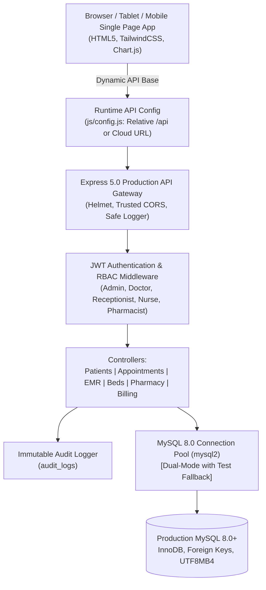

# 🏥 NovaCare Hospital Management System

[](https://nodejs.org/)
[](https://expressjs.com/)
[](https://www.mysql.com/)
[](https://tailwindcss.com/)
[](#automated-testing--verification)
[](LICENSE)

> **NovaCare Hospital Management System (HMS)** is a production-grade, enterprise healthcare information management platform designed for modern hospitals, medical centers, and specialized clinics. Engineered with Node.js, Express, MySQL 8.0, and clinical workflows.

---

## 📌 Executive Architecture & System Design



---

## 🌟 Core System Modules & Features

### 1. Executive Operations Dashboard & KPI Analytics
- **Live Metric KPIs**: Real-time aggregated totals for Active Patients, Today's Appointments, Inpatient Bed Occupancy Rate, Settled Outpatient Revenue, Pending Balances, and Critical Pharmacy Reorder Alerts.
- **Interactive Visualizations (Chart.js)**:
  - Weekly Patient Outflow Trend (Line Chart).
  - Department Consultation Distribution (Bar Chart).
  - Inpatient Ward Bed Occupancy Breakdown (Doughnut Chart).
- **Append-Only Clinical Audit Feed**: Real-time chronological activity stream.

### 2. Patient Directory & Universal Health Identifier (UHID)
- **Universal Health Identifier**: Auto-generates unique, standardized patient IDs (`NC-2026-XXXX`).
- **Comprehensive Demographics**: Full Name, DOB, Gender, Blood Group, Phone, Email, Residential Address, Emergency Contact Name/Phone, Known Drug/Food Allergies, Chronic Medical Conditions, Insurance Carrier & Policy Number.
- **Search & Filters**: Real-time debounced query search (by UHID, Name, or Phone) and Gender filters.
- **Audit-Safe Soft Deletion**: Patients are soft-deleted (`is_deleted = 1`); medical records, prescriptions, and financial audit history are strictly preserved.

### 3. Outpatient Appointment Scheduling & Conflict Engine
- **Doctor Time Slot Scheduling**: Assign appointments to specific doctors with designated room numbers, dates, and times.
- **Automated Conflict Detection (Double-Booking Protection)**: Rejects overlapping slots for the same physician with an HTTP `409 Conflict` status code and explanatory message.
- **Status Workflow**: Tracks appointments from `Scheduled` → `Completed`, `Cancelled`, or `No-Show` with mandatory cancellation auditing.

### 4. Medical Staff & Specialist Directory
- **Physician Profiles**: Department classification (Cardiology, Neurology, Pediatrics, Orthopedics, General Medicine), board qualifications, OPD room suites, consulting fees, and weekly duty schedules.

### 5. Electronic Medical Records (EMR) & Clinical Consultations
- **Clinical Encounter Documentation**: Symptoms, physical findings, diagnosis, and physician follow-up instructions.
- **Vitals Tracking**: Blood Pressure (systolic/diastolic), Heart Rate / Pulse (bpm), Body Temperature (°C), and Oxygen Saturation (SpO2 %).
- **Digital Prescriptions**: Structured formulary items, dosages, frequencies, treatment duration, and patient counseling instructions.

### 6. Inpatient Department (IPD), Wards & Bed Management
- **Visual Bed Status Matrix**: Interactive visual cards tracking Intensive Care Unit (ICU), General Male, General Female, Pediatric, and Executive Private Suites.
- **Bed Status Indicators**: `Available` (Emerald), `Occupied` (Rose), and `Maintenance` (Amber).
- **Admission & Discharge Lifecycle**: One-click patient admission to free beds, and clinical discharge summaries.

### 7. Pharmacy Formulary & Inventory Control
- **Formulary Catalog**: Brand name, generic chemical composition, therapeutic category, dosage form, unit pricing, current stock, and manufacturer.
- **Reorder Threshold Alerts**: Automatic status updates (`Available`, `Low Stock`, `Out of Stock`) when inventory drops below safety levels.
- **Medication Dispensation**: Deducts stock units against patient orders with audit tracking.

### 8. Billing, Invoicing & Financial Ledger
- **Multi-Item Invoice Generation**: Auto-calculates service charges (Consultation, Room Charges, Procedures, Medications, Laboratory Tests), applies discounts, and computes standard tax.
- **Payment Processing**: Records payments via Cash, Credit Card, Debit Card, Insurance, or Bank Transfer.
- **Balance Tracking**: Manages partial payments (`Unpaid` → `Partial` → `Paid`).
- **Printable Receipts**: Clean, print-ready hospital invoice receipts.

### 9. System Diagnostics & API Health Monitor
- **Health Check Endpoint (`GET /api/health`)**: Reports real-time service status, database engine and roundtrip latency, memory utilization, and uptime.
- **Zero Information Leakage**: Strictly shields internal database credentials, server filepaths, and stack traces.

---

## 🔐 Role-Based Access Control (RBAC) & Test Accounts

The system includes pre-seeded test accounts for role validation:

| Role | Username | Password | Permitted Actions |
| :--- | :--- | :--- | :--- |
| **System Administrator** | `admin` | `Admin@123` | Full access across all modules, staff user creation, system settings. |
| **Consulting Physician** | `dr.sarah` | `Doctor@123` | Appointments, EMR records, clinical diagnosis, prescriptions, bed status. |
| **Neurology Specialist** | `dr.marcus` | `Doctor@123` | Appointments, consultations, clinical patient history. |
| **Front Desk Reception** | `rec.john` | `Staff@123` | Patient registration, appointment booking, bed admissions, billing, payments. |
| **Head Nurse** | `nurse.emily` | `Staff@123` | Patient vitals, bed management, medication administration. |
| **Lead Pharmacist** | `pharm.david` | `Staff@123` | Medicine catalog management, stock reordering, prescription dispensation. |

> **PRO TIP**: The login modal includes **1-Click Quick Fill Buttons** to test any role with a single click.

---

## 🛠️ Technology Stack & Architecture

- **Backend**: Node.js 20/22 LTS, Express 5.x
- **Database**: MySQL 8.0+ (Production) / Isolated SQLite (Local CI/Test fallback)
- **Security**: JWT (JSON Web Tokens), Bcrypt.js (Password Hashing), Helmet (CSP & Security Headers), CORS origin whitelist
- **Frontend**: Vanilla ES6+, TailwindCSS, FontAwesome 6, Chart.js 4.x
- **Testing**: Node.js Native Test Runner (`node:test`, `node:assert`), Supertest
- **Containerization**: Docker, Docker Compose

---

## 🚀 Quick Start (Local Setup)

### Prerequisites
- Node.js (v18.0.0 or higher recommended)
- Git

### 1. Clone Repository
```bash
git clone https://github.com/<your-username>/novacare-hospital-management-system.git
cd novacare-hospital-management-system
```

### 2. Install Dependencies
```bash
npm install
```

### 3. Configure Environment Variables
```bash
cp .env.example .env
```
*(For instant local testing, default fallback SQLite operates automatically if local MySQL is not running)*

### 4. Run Automated Test Suite
```bash
npm test
```

### 5. Launch Application
```bash
npm start
```
Open your browser at:
`http://localhost:5000`

---

## 🧪 Automated Testing & Verification

The project includes an end-to-end integration test suite verifying all 12 mandatory deployment criteria:

```bash
npm test
```

### Test Suite Execution Output
```
> node --test tests/*.test.js

[DB] Storage active: SQLite (in-memory test)
▶ 🏥 NovaCare Hospital Management System - Live API Integration Tests
  ▶ A. Health Diagnostics & Static Assets
    ✔ GET /api/health should return 200 with healthy database dependency status
    ✔ GET / should serve frontend index.html with 200 OK
  ✔ A. Health Diagnostics & Static Assets
  ▶ B. Authentication & RBAC Authorization
    ✔ POST /api/auth/login with valid admin credentials should return 200 and JWT
    ✔ POST /api/auth/login with valid receptionist credentials should return 200 and JWT
    ✔ POST /api/auth/login with incorrect password should return 401 Unauthorized
    ✔ GET /api/auth/me with valid Bearer token should return user profile
    ✔ GET /api/patients without token should be rejected with 401 Unauthorized
    ✔ POST /api/auth/register by non-admin should be rejected with 403 Forbidden
  ✔ B. Authentication & RBAC Authorization
  ▶ C. Patient Registration, Retrieval & Soft Deletion
    ✔ POST /api/patients should register patient with UHID and return 201 Created
    ✔ POST /api/patients with missing required fields should return 400 Bad Request
    ✔ GET /api/patients should return list containing newly registered patient
    ✔ GET /api/patients/:id should return complete patient record
    ✔ PUT /api/patients/:id should update patient contact info
    ✔ DELETE /api/patients/:id should soft-delete patient preserving clinical history
  ✔ C. Patient Registration, Retrieval & Soft Deletion
  ▶ D. Appointment Scheduling & Conflict Validation
    ✔ POST /api/appointments should schedule valid appointment slot
    ✔ POST /api/appointments with overlapping slot for same doctor must return 409 Conflict
  ✔ D. Appointment Scheduling & Conflict Validation
  ▶ E. Wards & Inpatient Bed Allocation
    ✔ GET /api/beds should return list of wards and bed statuses
    ✔ POST /api/beds/admit should admit patient to available bed
    ✔ POST /api/beds/admit on already occupied bed should return 409 Conflict
    ✔ POST /api/beds/discharge should release bed and restore status to Available
  ✔ E. Wards & Inpatient Bed Allocation
  ▶ F. Billing & Payment Workflows
    ✔ POST /api/billing/invoices should generate invoice with line items
    ✔ POST /api/billing/payments should record partial payment and update balance
    ✔ POST /api/billing/payments settling remaining balance should update status to Paid
    ✔ GET /api/billing/invoices/:id should return complete invoice with audit line items and payments
  ✔ F. Billing & Payment Workflows
✔ 🏥 NovaCare Hospital Management System - Live API Integration Tests
▶ 🔒 Security, Repository Integrity & Production Config Tests
  ✔ Frontend JavaScript files MUST NOT contain hardcoded localhost or 127.0.0.1
  ✔ Frontend HTML file MUST NOT contain hardcoded localhost or 127.0.0.1
  ✔ .gitignore MUST exist and strictly exclude node_modules, .env, and local database files
  ✔ .env.example MUST exist and contain ONLY safe placeholders with NO real passwords or private keys
✔ 🔒 Security, Repository Integrity & Production Config Tests

ℹ tests 28
ℹ suites 8
ℹ pass 28
ℹ fail 0
```

---

## 🌐 Production API URL Configuration (Zero Localhost Leak)

NovaCare enforces dynamic environment-specific URL resolution:
1. **Same-Origin Hosting** (Frontend served by Express): Automatically requests relative `/api/*` endpoints. Works out-of-the-box on any domain or HTTPS port without code changes.
2. **Decoupled Hosting** (e.g., Frontend on Vercel/Netlify + Backend on Render/Railway): Configured through `window.__APP_CONFIG__.API_BASE_URL` in `public/js/config.js` or `PUBLIC_API_URL`.
3. **Localhost Guarantee**: Verified by automated security test `tests/security.test.js` ensuring no hardcoded `localhost` or `127.0.0.1` appears anywhere in frontend assets.

---

## 📡 Complete REST API Endpoint Directory

| Module | Method | Endpoint | Access Roles | Description |
| :--- | :--- | :--- | :--- | :--- |
| **Health** | `GET` | `/api/health` | Public | Real-time system diagnostics & DB connectivity |
| **Auth** | `POST` | `/api/auth/login` | Public | Authenticates credentials and returns JWT token |
| **Auth** | `GET` | `/api/auth/me` | Authenticated | Retrieves current authenticated profile |
| **Auth** | `POST` | `/api/auth/logout` | Authenticated | Terminates session and logs audit event |
| **Auth** | `POST` | `/api/auth/register` | `ADMIN` | Provisions new staff account |
| **Dashboard** | `GET` | `/api/dashboard/stats` | Authenticated | Real-time aggregated hospital KPIs |
| **Dashboard** | `GET` | `/api/dashboard/charts` | Authenticated | Weekly trends & department distributions |
| **Dashboard** | `GET` | `/api/dashboard/recent-activity` | Authenticated | Chronological audit action stream |
| **Patients** | `GET` | `/api/patients` | `ADMIN, DOCTOR, RECEPTIONIST, NURSE` | Paginated search & list with gender filter |
| **Patients** | `GET` | `/api/patients/:id` | `ADMIN, DOCTOR, RECEPTIONIST, NURSE` | Complete patient profile, EMR & billing |
| **Patients** | `POST` | `/api/patients` | `ADMIN, RECEPTIONIST, DOCTOR` | Registers patient with generated UHID |
| **Patients** | `PUT` | `/api/patients/:id` | `ADMIN, RECEPTIONIST, DOCTOR, NURSE` | Updates patient demographics |
| **Patients** | `DELETE`| `/api/patients/:id` | `ADMIN, RECEPTIONIST` | Soft-deletes record (preserves audit history) |
| **Doctors** | `GET` | `/api/doctors` | Authenticated | Lists physicians by department and status |
| **Doctors** | `GET` | `/api/doctors/:id` | Authenticated | Retrieves physician profile and schedule |
| **Appointments**| `GET` | `/api/appointments` | Authenticated | Lists appointments with doctor/date filters |
| **Appointments**| `POST`| `/api/appointments` | `ADMIN, RECEPTIONIST, DOCTOR` | Schedules appointment with conflict validation |
| **Appointments**| `PATCH`| `/api/appointments/:id/status` | `ADMIN, RECEPTIONIST, DOCTOR, NURSE` | Updates appointment lifecycle status |
| **Clinical** | `GET` | `/api/consultations` | `ADMIN, DOCTOR, NURSE` | Lists clinical consultation records |
| **Clinical** | `POST`| `/api/consultations` | `ADMIN, DOCTOR` | Saves clinical notes, vitals & prescriptions |
| **Wards/Beds**| `GET` | `/api/beds` | Authenticated | Lists wards, beds, and occupancy status |
| **Wards/Beds**| `POST`| `/api/beds/admit` | `ADMIN, RECEPTIONIST, DOCTOR, NURSE` | Admits patient to available bed |
| **Wards/Beds**| `POST`| `/api/beds/discharge` | `ADMIN, DOCTOR, NURSE, RECEPTIONIST` | Discharges inpatient and frees bed |
| **Pharmacy** | `GET` | `/api/pharmacy/medicines` | Authenticated | Formulary catalog with stock levels |
| **Pharmacy** | `POST`| `/api/pharmacy/medicines` | `ADMIN, PHARMACIST` | Adds medicine to hospital catalog |
| **Pharmacy** | `POST`| `/api/pharmacy/dispense` | `ADMIN, PHARMACIST, NURSE` | Deducts stock units against prescription |
| **Billing** | `GET` | `/api/billing/invoices` | `ADMIN, RECEPTIONIST` | Hospital billing and invoice ledger |
| **Billing** | `GET` | `/api/billing/invoices/:id` | `ADMIN, RECEPTIONIST` | Invoice details, line items, and payments |
| **Billing** | `POST`| `/api/billing/invoices` | `ADMIN, RECEPTIONIST` | Issues itemized patient invoice |
| **Billing** | `POST`| `/api/billing/payments` | `ADMIN, RECEPTIONIST` | Records payment against invoice balance |

---

## 🚢 Live Hosting & Deployment Guide

For full instructions, refer to **[DEPLOYMENT.md](DEPLOYMENT.md)**.

### Summary Deployment Workflow
1. **Push to GitHub**:
   ```bash
   git add .
   git commit -m "feat: complete NovaCare HMS"
   git push origin main
   ```
2. **Provision MySQL 8.0 Database** on Railway, Render, AWS RDS, or PlanetScale.
3. **Deploy Web Service** connected to your GitHub repository.
4. **Set Production Environment Variables**:
   - `DB_HOST`, `DB_PORT`, `DB_USER`, `DB_PASSWORD`, `DB_NAME` (or `DATABASE_URL`)
   - `JWT_SECRET` (32+ character random string)
   - `CORS_ORIGIN` (Your live domain, e.g., `https://novacare.yourdomain.com`)
5. **Run Migrations & Seeds**:
   ```bash
   npm run db:migrate
   npm run db:seed
   ```
6. **Verify Live Endpoint**:
   Check `https://<your-live-domain>/api/health`.

---

## 🔒 Security Best Practices

1. **No Secrets in Source**: `.gitignore` strictly protects `.env`, certificates, and database files.
2. **Encrypted Passwords**: Bcrypt with work factor 10.
3. **Auditing**: Every critical clinical action is recorded in `audit_logs` with timestamps, actor IDs, and IP addresses.
4. **CORS Hardening**: Wildcards (`*`) are disallowed; explicit trusted origins must be specified via `CORS_ORIGIN`.
5. **Helmet CSP**: Restricts asset sources to trusted CDNs for Chart.js and FontAwesome.

---

## 📄 License

This project is licensed under the MIT License — see the [LICENSE](LICENSE) file for details.
